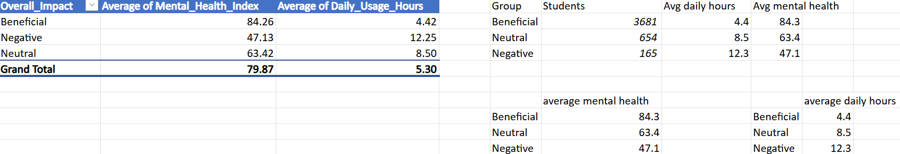
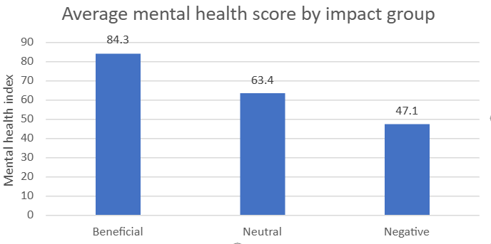
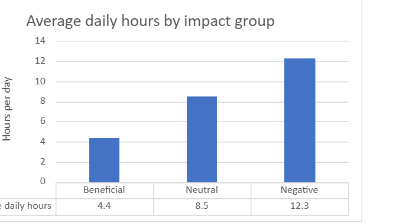

# Social Media Impact on Students: Excel Analysis

**Question:** Does heavier daily social media use go with lower mental health?

**Tool:** Excel (PivotTable and charts)

**Data:** A public dataset of 4,500 students with 16 columns, including daily usage hours, a mental health index, and an overall impact label (Beneficial, Neutral, or Negative). Source: [add the Kaggle link here].

## Approach

1. Opened the CSV in Excel and checked the columns, data types, and missing values. The dataset has 46 blank stress scores and 85 blank GPA values. Those columns are not used in this analysis, and the columns that are used have no blanks.
2. Built a PivotTable that groups students by `Overall_Impact`.
3. For each group, calculated the number of students, the average daily usage hours, and the average mental health index.
4. Charted the results.

## Results

| Group | Students | Avg daily hours | Avg mental health index |
|---|---|---|---|
| Beneficial | 3,681 | 4.4 | 84.3 |
| Neutral | 654 | 8.5 | 63.4 |
| Negative | 165 | 12.3 | 47.1 |
| All students | 4,500 | 5.3 | 79.9 |

## Key finding

Heavier use goes with lower mental health scores. Students in the Negative group averaged about 12 hours a day and a mental health index of 47, compared with about 4 hours and 84 for the Beneficial group.

## Limitations

- This shows a link, not proof that social media causes lower mental health. Students who are already struggling might also use social media more.
- The groups are very uneven. The Negative group is only 165 of 4,500 students (about 3.7%), so I would be careful about reading too much into it.
- The data is self-reported, and I don't know how the overall impact label was assigned.
- The relationships in this dataset are unusually clean, so I would check how it was collected before relying on it.
- Averages hide how spread out the values are, and I did not run any significance tests.

## Files

- `Social_Media_Impact_Analysis.xlsx`
- `Social_media_impact_on_life.csv`
- `images/`

## Next steps

- Group students into usage bands (for example 0-3, 3-6, 6-9, and 9+ hours) and compare mental health across them.
- Compare late-night users with other students on sleep and GPA.
- Repeat the analysis in R and Python.
